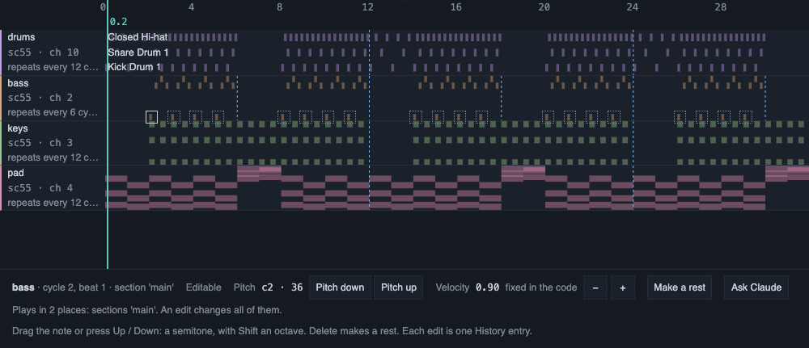
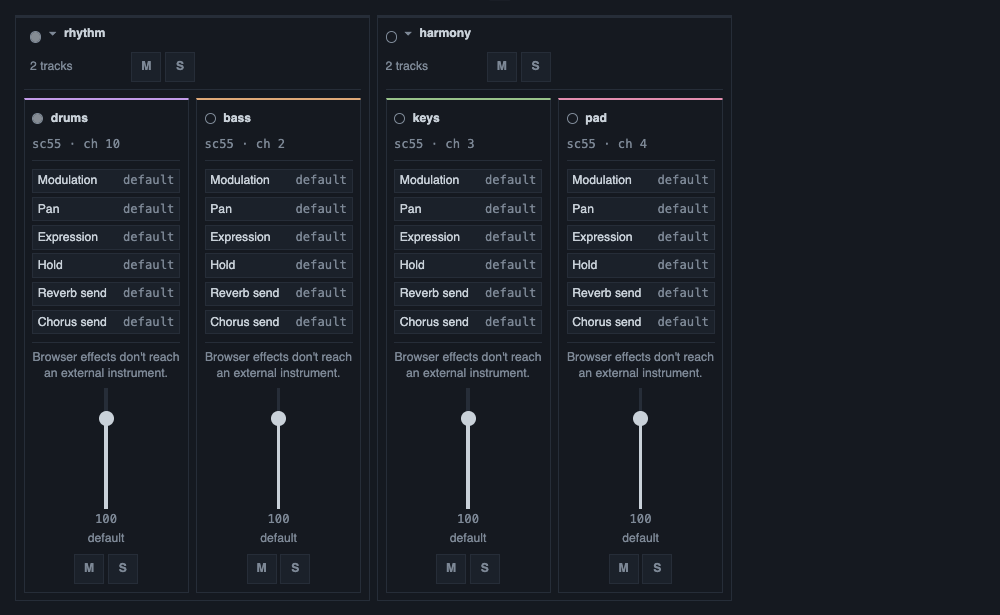

# Small edits and editing by hand

A piece grows by small steps. This page shows how Claude changes a few lines without sending the whole
piece again, how your own edits fit in, and what you can change yourself in the Jam view, the Timeline
and the Mixer.

## Claude changes a few lines

For a long piece, Claude does not send all the code again. It sends only the change, through the
`edit_code` tool, and Moontide builds the whole program from it. A change that matches nothing, or
matches twice without being told, is refused as a whole and nothing reaches the page. For a new piece
or a rewrite of most of the lines, Claude sends the whole code with `set_code`.

A change can take over at once, on the next bar or on the next phrase. Claude asks for a bar or a
phrase when it wants a clean scene change. While a change waits for its line, the top bar counts down
to it. A newer change replaces it, and Stop cancels it.

## Your own edits

You can edit the code in the page at any time. Your edit plays when you press Ctrl+Enter, and it
becomes a version, like any change of Claude. In the Session drawer, the Settings card sets when your
own edits take over: now, on the next bar or on the next phrase. Claude's changes choose their own
timing.

Claude reads your hand edits before it changes the music, and keeps them. Text that you typed but did
not play is replaced by the next change from Claude, so press Ctrl+Enter on an edit you want to keep.

## The harmony line

The code can say which harmony it means with one line, placed above the patterns:

```
const harmony = 'C:minor'
```

This line plays nothing and is never a track. It is a note for the page, and for Claude, about the
key you have in mind. Without it, the page works out the scale from the notes it hears.

## The Jam view

The Jam view shows a scale on a piano or on a guitar neck, for a person who plays along. When the code
has a harmony line, it shows two lines side by side: Declared, which is what the code says, and Heard,
which is what the notes say. The page gives no verdict between them. You see both and decide.

When the notes fit several scales, the Jam view proposes one and says why in a sentence, for example
"Proposed: C major, C is the note heard most." It takes the declared scale of the section that plays
when that scale is among the ones that fit. Otherwise it takes the scale the notes support most.
"Scales that fit, click to switch:" lists them, and one click or Enter switches the whole view. Your
pick holds while the same scales fit, and it is forgotten when you reload the page.

When the scales differ in their notes and the code declares none of them, the page cannot choose. It
turns the warnings off, says why, and lists the scales without a switch.

The piano is coloured like the guitar neck, with the same legend. Every role also has a shape or a text
cue, so the view reads without colour. MIDI drum tracks are not counted as pitches. A track whose port cannot be read keeps counting.

## Edit notes on the Timeline



*The Timeline with one bass note selected. The panel under the lanes names the note and where it plays,
says that an edit would change it in two places, and offers the edits. The notes that share it have a
dotted ring.*

On the Timeline, click a note to select it. Then:

- Drag it up or down, or press the Up and Down keys, to change its pitch by semitones.
- Press Delete or Backspace, or use "Make a rest", to turn it into a rest.
- Use the two velocity buttons to change its velocity by a tenth.

The page checks an edit before it writes it. If one edit changes the note in several places, it says so
first, and the other notes that share it get a dotted ring. Several presses in a row gather into one
version. An edit takes over with your usual timing for hand edits.

The page edits a note only when one plain place in the track's own code holds it. A note made by a
function or by chance, a sample, a note written in degrees, a note shifted by something else or a note
that comes from code shared by several tracks is not edited, and the page says why. A drag, a key or a
button on such a note moves nothing. It opens the Ask box with a ready-made request, for example
"Raise note c3 at cycle 4, beat 1 of 't1' by 2 semitones." The request goes to Claude only when you
press Enter.

To pick a range of whole cycles on one lane, drag across it, or hold Shift and press Left or Right.
Use "Ask Claude" to send the range with the notes in it.

## Move the Mixer



*The Mixer of a small demo piece. Each track has its own strip with a fader, a mute and a solo, and the
two groups of the song have a frame around their strips. The light by a name is lit while a note of that
track is heard.*

In the Mixer, a fader, a mute or a solo rewrites the code as one change and makes one version. A control
that the Mixer cannot apply safely is turned off and says why. Ask Claude for that change instead. For
the groups of a song, see [Song structure](song-structure.md).

## What was verified

**Verified:**

- The edits of a few lines, the harmony line, the Jam view, the Timeline edits and the Mixer moves are
  covered by automated tests, and a drive of the real page in headless Chrome checks them.
- A benchmark compares the text sent and the time taken by a small edit and by a whole rewrite, on
  pieces of three sizes.

**Not verified:**

- Timeline edits by hand with the mouse, the keys and the buttons in a real session.
- Picking a note on a dense lane and in a wide 4K window, and fast presses on a slow piece.
- Editing a chord, a rest inside a chord, and a note that plays in several places, and hearing the
  result in every place.
- Whether the proposed scale and its reason are right by ear on real modal pieces.
- How the piano marks read at 1080p and at 4K.
- Whether a screen reader says the names in the Jam view.
