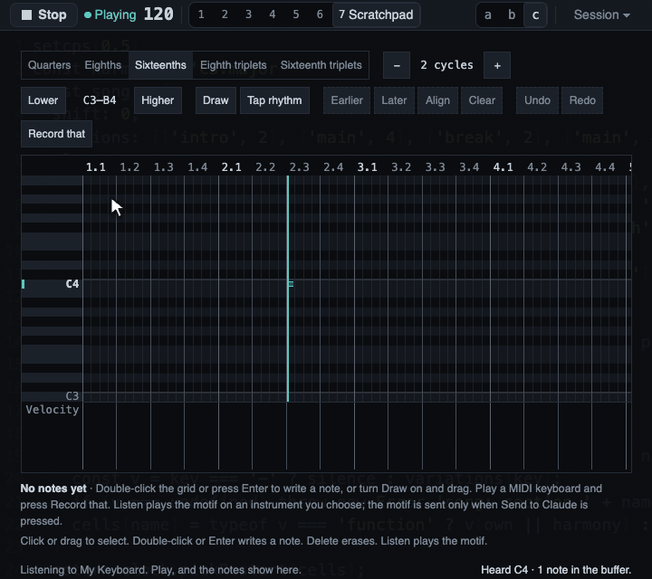

# Playing in from a keyboard

**Early experimental:** playing in is part of the Scratchpad, and the whole Scratchpad is early
experimental. A known problem: a key you hold is often recorded as a very short note. In the takes tried
by hand, only the first note of a take kept the length it was held for. Until this is fixed, look at the
lengths on the roll after Record that and correct them before you send: select the notes, then Shift with
Left or Right changes their lengths (see [The Scratchpad](scratchpad.md#select-first-then-draw)).

You can play a motif on a MIDI keyboard. The page hears it, puts each note on the music's cycle where you
played it, keeps the last cycles in a rolling buffer, and shows the buffer on the Scratchpad's roll as you
play. Record that then turns the buffer into the motif on the roll, after the fact. This page assumes you
know [the Scratchpad](scratchpad.md).

Nothing you play is sent to an instrument. Playing only listens. The page sends a motif to an instrument
only when you press Listen.

## Name your keyboard

Name the keyboard in `instruments.json`, with an `inputs` list beside `instruments`:

```json
{
  "instruments": [
    { "id": "mt32", "model": "mt32", "port": "Mt32EmuPort" }
  ],
  "inputs": [{ "port": "My Keyboard" }]
}
```

- **The name:** write the exact and full name of the input port, as your system lists it. Unlike an
  output, an input is never matched by a part of its name, because a loose match could pick the wrong
  device. If the name is not connected, the Scratchpad says so and lists the inputs it does see, once MIDI
  is allowed, so a first try shows you the right name. A name carried by two connected inputs is refused
  and said, never guessed.
- **How many:** at most 4 inputs.
- **The list is optional**, but a file still needs its instruments.
- **You write it:** Claude may propose the line in the chat, but nothing writes it for you. A change made
  to an instrument from the Instruments view keeps your `inputs` as they are.

## Permission

Listening needs the same browser permission as the MIDI output, and the page asks once. The first time, it
asks only when you press **Allow MIDI to listen** in the Scratchpad, never by itself. If the browser
refuses, the Scratchpad says so in words and asks nothing more. Allow MIDI in the browser's site
settings, then reload.

## When it listens

In every view, while the page's tab is visible and holds the music. A tab that is hidden, or has lost the
music to another tab, listens to nothing and says so, so there is never a second buffer. Showing the tab
again listens again, with no reload. A window covered by another window may or may not count as hidden,
depending on the system.

## What it hears

- Notes, on every channel.
- It ignores the sustain pedal, pitch bend, aftertouch, other controllers, clock and active sensing.
- A note from a device that sends no time stamp, a time stamp of zero, or a stamp too far from the
  present is refused and said. It is never placed at a guess.

The page places each note by the time stamp the system gives it, never by the time its own code happens to
run, because a busy page can run its code late and the stamp does not move.

## The buffer

The buffer keeps the last 8 cycles, which is the longest motif the roll holds. It ends with the cycle
that is playing now.

- It lives in memory only. A reload empties it, and nothing is saved or written to a file.
- A note from before the window is cut at its edge.
- A held note is closed when the cable is unplugged, the tab is hidden or the setup changes.
- It keeps at most 2000 notes. Past that, the newest notes are not kept, and the status says so.
- Every note is kept with its velocity as played, even a weak ghost note. Nothing is filtered by velocity
  or length. The cleaning is left to you or to Claude.

## Seeing the buffer as you play

While the Scratchpad is open and an input is listened to, the roll shows the last 8 cycles of the buffer under a
playhead that runs across them and starts again at the end.

- Each note you play appears in the accent colour as you play it.
- A key you hold lights its key in the pitch column, and its note grows.
- The roll gains rows if you play a pitch it did not show.
- Before the first note, the roll shows where the music is, so you can feel the beat.
- The ruler numbers the 8 columns 1 to 8. These are not the music's own cycle numbers, because the
  keyboard's count and the music's differ by a whole number after a Stop and a Play. The beats inside a
  cycle still line up.

This view only reads. It sends nothing to an instrument and writes nothing to the History.

## Record that

**Record that** replaces the motif on the roll with what the live view shows, in one step that Undo takes
back.



*A phrase played on the keyboard, then Record that. The live view shows each note as it comes and says
what was heard. After the press, the notes stand on the roll as a motif, and the line under the roll says
how many were recorded.*

- The notes are placed on the same 8 columns, quantized to the roll's grid, with the velocities as
  played.
- The empty cycles before the first note are dropped, so the motif starts at the cycle of your first note
  and lasts up to the last. No phrase is guessed.
- A note the roll cannot show, outside C0 to B8, is left out, and the line says how many.
- It writes nothing to the History or to the code, and the music is left as it was.
- After the press the buffer is empty. Pressing again says there is nothing to record, and Undo brings
  back the earlier motif but not the notes. The reason is that a take is finished when it is kept: notes
  left in the buffer would be taken again by the next press and drawn over the new motif.
- A take that starts in the last cycle of the 8 and goes on into the first is written as it lies on the
  ring, the later bar first.

The motif holds exactly the notes that were on the screen. What can still differ is told in the line: a
cut or a merge of the same pitch, and notes outside the roll's range.

## With the music stopped

The page keeps listening and keeps counting cycles by the tempo, so you can play a motif with no music
running, and Record that works. On Play, the count moves on to the next whole cycle of the music, so the
music's downbeats stay downbeats. Notes played before a Play have no meaningful place against the new
music.

## What the Scratchpad says when it is not listening

The Scratchpad says in its own words why it is not listening, and what to do:

- **No setup file, or no input named:** it shows the line to add to `instruments.json`.
- **A file with a problem:** the MIDI popover shows the problem.
- **MIDI not allowed yet:** press Allow MIDI to listen.
- **Refused by the browser:** allow MIDI in the site settings and reload.
- **No Web MIDI:** use Chrome or Edge (see [Troubleshooting](troubleshooting.md)).
- **Another tab holds the music:** take it back to listen here.
- **A hidden tab:** show the tab, and it listens again.
- **The name is not connected:** it lists the inputs it sees, so you can copy the right name.
- **The input was unplugged:** plug it in again. The page notices by itself.
- **Two inputs with the same name:** the page cannot tell them apart. Rename or unplug one.
- **Connected but could not be opened:** another program may be using it. Close that program, then plug
  the keyboard in again or reload the page.

When it listens, the line reads "Listening to" and the name. When a time stamp is refused, the line says
why and the note is not kept.

## How close a played note lands

The timing was measured before the input was built. On a loopback port in real Chrome, at 60, 90, 120,
140 and 180 BPM, with the music playing and with it stopped, every note landed on its place within 6 ms.
The worst error was 0.33 ms with music, and the worst spacing error was 0.14 ms with it stopped. A loopback
port is a pipe inside one computer. It adds no delay of its own, and so it cannot show the delay of a real
keyboard.

## What was verified

**Verified:**

- On a loopback port in real Chrome, the page's own input placed every note within 6 ms of its place on
  the cycle grid, at the five tempos above, with the music playing and with it stopped. This is one Mac and
  one Chrome.
- Record that writes exactly the notes shown, then empties the buffer, and Undo brings the earlier motif
  back. This was checked with a fake keyboard in real Chrome and by automated tests.
- By hand, with a real keyboard on one Mac and the music playing over a beat, chords landed on the roll
  where they were played, an unplug and a plug were noticed with the page open and no reload, and a
  covered Chrome window paused listening and said so.

**Not verified:**

- A real keyboard's own delay and its time stamps, which a loopback cannot show and the hand checks did
  not measure. Held notes from a real keyboard came out too short, the known problem at the top of this
  page.
- A guitar-to-MIDI unit, which makes many weak extra notes and has a tracking delay of its own.
- Windows and Linux time stamps.
- A source that sends no time stamp. Such a note is refused and said, never placed at a guess.
- Whether a window covered by another window counts as hidden, on each system.
- How the live view feels with a real keyboard: whether the playhead and the live notes make it easy to
  land in the bar.
- A real keyboard playing a motif that is recorded and sent to Claude. Its moment was checked with a fake
  keyboard only.
