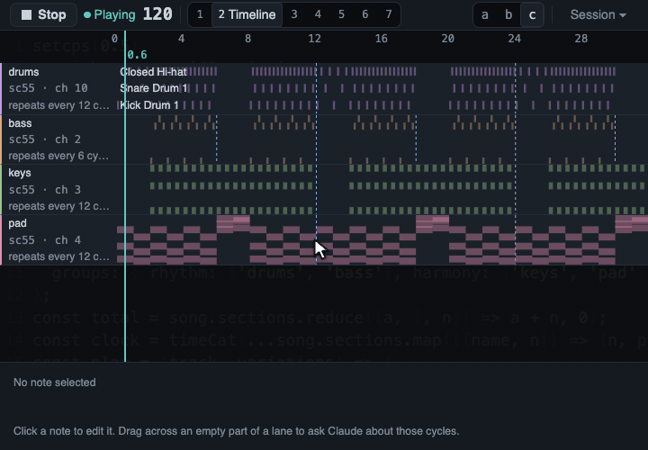

# Asking from the page

You do not have to type in the chat to ask for a change. A right-click in the page sends Claude a
request, and the page shows what became of it. This page explains what a request carries, how it
reaches Claude and how to read the Requests list.

## Right-click to ask

Right-click anything in the page. A small box opens: type your request, press Enter to send it. The
request carries what you pointed at, so you can say what you want and leave out the where. See
[The page and its views](the-page.md) for the keys of the Ask box.

*A right-click on a note of the Timeline. The box that opens already says what was pointed at, here a
lane and a cycle. After Enter, the box closes and the Requests button in the top bar lists the request,
which waits for Claude's next action.*

A request is always kept, but Claude only sees it at once when page requests are Live. Claude
usually starts the monitor itself after one of its replies from Moontide. If the Session drawer says
Waiting, [turn them on](#turn-them-on-or-off), or the request waits for Claude's next action in
Moontide.

On the Timeline, a right-click also sends the moment under the pointer:

- the cycle and the beat;
- the version that was playing;
- the notes that sound there or start in the same sixteenth of the bar, with their velocities and, for
  a MIDI track, its instrument and channel.

A right-click on a section, a track, a cell or a group of the Song grid asks about that thing. A failed
change can be asked about too: the banner has an Ask Claude button that carries the error.

## Live or waiting

Claude has to notice a request without you typing in the chat. The Session drawer says how requests
reach it, in its Page requests card:

- **Live:** Claude runs a small helper called a monitor. Each request reaches Claude at once.
- **Waiting for Claude:** nothing runs in the background. A request reaches Claude with its next
  action in Moontide, for example its next change to the music.

The (i) next to the state explains how to switch. Page requests need an open page, so start Moontide
first.

## Turn them on or off

In the Code tab of the Claude app, ask Claude to turn page requests on or off. Claude calls Moontide's
`set_page_requests` tool.

In Claude Code in a terminal, type one of these:

- `/mcp__moontide__page-requests-on` makes them live.
- `/mcp__moontide__page-requests-off` makes them wait.

These names assume you added Moontide under the name `moontide`, as the [Install](install.md) page
does. Off holds until you turn them on again. A request sent while they wait is not lost: it arrives
with Claude's next action.

## The monitor and its permission

A live monitor lasts at most 30 minutes. Claude starts it again when a reply from Moontide asks it to.

Claude Code asks your permission before it starts the monitor, because it runs a command. You can
approve it each time. If you want a narrower permission rule instead, see the permissions section of
the Claude Code documentation. Do not allow broad `node` commands: a rule that wide lets Claude run
any script.

## The Requests list

The Requests button in the top bar appears after you send your first request. It counts the requests
still in flight and opens a list with one row for each request: what happened to it and how long ago.

A request goes through these states, in the page's own words:

- **Sent**, then **Waiting for Claude's next action** or **Received**.
- **Claude has started on it.** This means Claude made a call to Moontide after the request arrived.
  It does not promise that a change will follow.
- **Waiting for its line.** Claude's change is ready and waits for the next bar or phrase.
- **Applied as v12.** The change is in the History view as that version.
- **Failed** with the error, when the change could not play.
- **Replaced by a newer change** or **Canceled**, when a newer change took its place or Stop ended the
  wait.
- **Answered** or **Declined**, with Claude's sentence, when Claude answers in words and changes no
  music.
- **Not sent**, with the reason, when the page could not send it.
- **Connection lost**, when the page lost its link to Moontide and cannot tell what happened.

A request shows as applied only when Claude names it with its change. The page never guesses a link
from timing, so a change that happens to follow your request says nothing about it.

After 30 seconds without news, a row reads No change yet and keeps counting. That is not a failure:
Claude may still be working, or it may not have seen the request. The page does not guess.

Click a row to see the whole request and what its state means. Finished rows move to a short Recent
list after 30 seconds. Nothing is kept after Moontide stops: the rows live in memory only, and your
request text never reaches the disk.

## What was verified

**Verified:**

- The path of a request, from the right-click to Claude and back, and each state of the list are
  covered by automated tests and by a drive of the real page in headless Chrome.
- Before the states shipped, fresh Claude sessions were each given one plain request from the real
  page, with no hint about ids or tools. In every session whose request changed the music, Claude named
  the request with its change, and in every session whose request needed only an answer, Claude closed
  it in words. The bar was four out of five for each kind, and it was met.

**Not verified:**

- Whether the request states read well in a short real session: plain, honest wording, and whether
  "started" can be trusted.
- How the Requests list opens on a send and folds after the last finish at 1080p and at 4K, in each
  layout.
- Whether a screen reader says the states right.
- The commands for the monitor on Windows and Linux.
