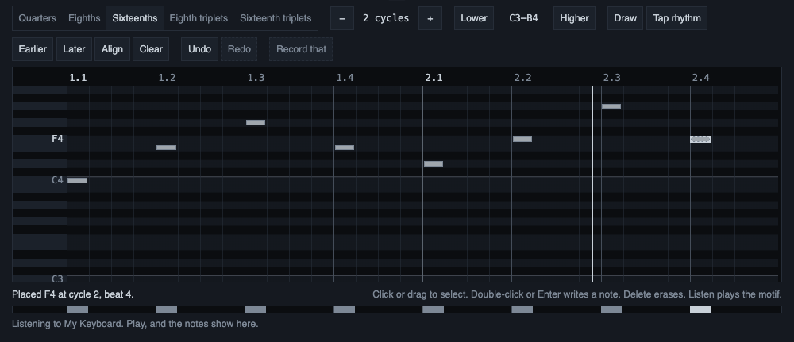
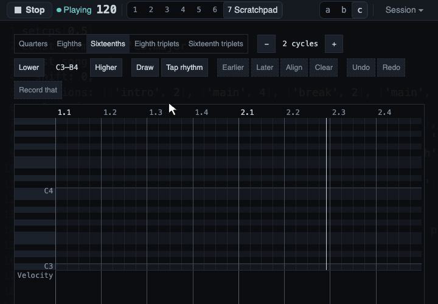

# The Scratchpad

**Early experimental:** the whole Scratchpad is new and may still change, in how it looks and in how it
works. A known problem: a key you hold while playing in is often recorded as a very short note (see
[Playing in from a keyboard](keyboard-input.md)). The [known limits](troubleshooting.md#known-limits)
list the rest.

The Scratchpad is a piano roll where you draw, tap or play in a short motif, and read it before it is
used for anything. Open it with key 7 (see [The page and its views](the-page.md)). It is a view of the
page, never a player of the music. It changes no code, it stores nothing, and it sends a motif to Claude
only when you press Send to Claude. The only thing in it that makes a sound is the Listen button, and
only when you press it.

This page is about making a motif on the roll and hearing it. [Playing in from a keyboard](keyboard-input.md)
covers recording from a MIDI keyboard, and [Sending a motif to Claude](sending-a-motif.md) covers the
last step. Listen needs the setup file of [MIDI instruments and the setup file](midi-instruments.md).

## The roll

A motif is a few cycles of notes on a grid. Time runs from left to right, pitch from bottom to top, and
under the roll a velocity lane shows how hard each note is.

*The roll with a short motif written by double-clicking the grid. Each grey bar is a note. The small
bars under the roll are the velocity lane, one for each note, and the line under it says what the last
click did.*

A new motif is 2 cycles long. The buttons Fewer cycles and More cycles change the length, from 1 to 8
cycles. Making it longer keeps every note. Making it shorter is refused, with the cycle named, while a
note starts in a cycle that would go. A note that only runs into the cycles that go is cut at the new end,
and the line under the roll says how many.

## The grid

The roll has five grids. Each note starts on a step of the grid and lasts a whole number of steps.

- **Quarters:** four steps per cycle.
- **Eighths:** eight steps per cycle.
- **Sixteenths:** sixteen steps per cycle. This is the default.
- **Eighth triplets:** twelve steps per cycle.
- **Sixteenth triplets:** twenty-four steps per cycle.

A coarse grid cannot hold a fast rhythm, and a very fine one turns a loose hand into a false rhythm.
Triplet material needs a triplet grid.

A change of grid moves every note at once. A start goes to the nearest step, a tie going to the earlier
step. A length goes to the nearest whole step, a tie going down, and never below one step. The line
under the roll says how many notes moved and how many merged.

Notes of one pitch never overlap, because the phrase that goes to Claude cannot say an overlap. Two notes
of one pitch in the same cell merge into the stronger one, and a note stops where the next note of its
pitch starts. The line says what was cut or merged.

## Velocities

A velocity runs from 0.01 to 1.00. A new note starts at velocity 0.80, and the last value you used is
not remembered. To change it, use the velocity lane under the roll: it changes the velocity of the
selected notes.

## Select first, then draw

A drag on empty space of the roll selects: it draws a dashed rectangle and selects the notes it touches.
This is on purpose. With selection first, a stray click costs nothing, and you can move a motif as a
group.

*Draw turned on with its button, a short drag and a longer one, and Draw turned off. While it is on, the
Draw button is outlined and each drag writes a note as long as the drag.*

- **Select:** a click on a note selects it. Shift, Ctrl or Cmd adds to the selection.
- **Write a note:** double-click the grid, or press Enter at the cursor, or turn Draw on and drag. Draw
  is a visible button (the key d) with its state read out, so the same drag never does two things
  without your knowing which mode you are in.
- **Erase a note:** select it and press Delete, or right-click it. A right-click on the roll erases a
  note, while the rest of the page keeps opening the Ask box. A right-click with Ctrl held erases
  nothing, because on a Mac it is the same press as Ctrl+click, which adds to the selection.

A selection is one group:

- The arrow keys move it a step or a semitone.
- Alt with the arrows moves it a beat or an octave.
- Shift with Left or Right changes the lengths.
- Delete erases it.
- A move that cannot be made whole, because a note would pass the end or the highest or lowest pitch,
  is refused and said. It is never squeezed, so the notes keep their spacing.

A key held down counts as one Undo step, not one for each repeat.

## Earlier, Later, Align and Clear

- **Earlier** and **Later** move the selection, or the whole motif when nothing is selected, a single
  step of the grid.
- **Align** (the key l) moves the whole motif so that its first note starts on the nearest beat, an exact
  half going to the earlier beat. It keeps the lengths, pitches, velocities, spacing and, for a recorded
  motif, the moment. A player is usually a little early or late as a whole, so moving the motif keeps
  their feel where a quantize would change it. Align is refused, with the reason, when the last note
  would pass the end of the motif. It never makes the motif longer.
- **Clear** empties the roll with no question, because Undo brings the notes back and the line says so.

## Undo and Redo

The Scratchpad has its own Undo and Redo, 100 steps deep. They never touch the History or the code. Use
the buttons, or Ctrl or Cmd with Z for Undo, and with Shift for Redo (Ctrl+Y redoes too). The keys work
while focus is inside the Scratchpad, so the code editor's own undo is never taken.

After an Undo or a Redo the roll scrolls so the notes it brought back or changed show, or the notes
that remain when it only took notes away. If the cursor is too far from them to show in the same
view, it moves onto the nearest of them.

## The pitch rows

The roll starts with a window of two octaves and grows to hold every note, with room for two
semitones, in whole octaves between C0 and B8. No note is ever hidden, also not after an Undo, and a
readout names the range shown. Lower and Higher move the starting window only. When the rows are taller
than the box, the box scrolls up and down while the ruler, the piano names and the velocity lane stay in
place. The roll takes all the width it has, and scrolls sideways when the beats do not fit.

## Tap

Tap rhythm (the key t) lets you tap a rhythm on the Space key while the music plays. It needs the music
playing, and says so when it does not, because the music's clock places the taps. A tap lands where the
music is in the motif, snapped to the grid, at the pitch of the cursor. If the key press carries a time
stamp that cannot be trusted, the line says why and nothing is placed. Tap turns itself off when the view
closes or the music stops.

## Listen

Listen plays the motif on one of your instruments, so you can hear it before you send it to Claude. It
needs `instruments.json` and it sends only on your press.

- **Where:** a menu lists each instrument of your file with each of its channels, for example
  `mt32 · channel 3`. The output is found by a part of the instrument's port name, as the music's own
  `.midi()` ports are. If no output contains the name, or several do, Listen says so and plays nothing.
  An instrument you switched off is in the list, and Listen on it says why it did not play.
- **No sound change:** Listen sends note-on and note-off and nothing else: no program change, no
  controller, no reset. The sound on the channel is the one the music or you already set there, which is
  the sound the motif will have in the music.
- **In the music and At once:** In the music, the default, waits for the next cycle line of the music and
  plays from there, so the motif falls on the beat. The line says which cycle it waits for. It needs the
  music playing, and says so if it is not. At once plays now, with or without music.
- **Loop:** with Loop on, the motif starts again after its last note, on the music's cycle lines for In
  the music. A change you make on the roll is heard on the next pass.
- **Stop:** it ends the play and sends a note-off for each note that sounds and for each note already on
  its way. It does not send All Notes Off, so a track of the music on the same channel keeps playing.
- **What stops a play by itself:** a hidden tab (a hidden tab cannot keep time), another view opening or
  the Scratchpad closing, leaving the page, the output being unplugged, and, for In the music, the music
  stopping. Each is said in plain words.
- **The first press:** if the page has not asked for MIDI yet, the first Listen press asks for it and
  says it waits. Stop cancels. Allowing MIDI makes the page reset the instruments it finds, so a press
  right after the allow can be answered with "try again in a moment". The next press plays.

Two Heads up sentences can appear next to the state of Listen. Neither stops it. One says that a track of
the playing code, not muted, uses the same instrument and channel, and names the track, so both would
sound on it. The other says that the instrument plays one note at a time and the motif holds a chord,
which would be heard as one note. That one needs `"monophonic": true` in the instrument's model, which the
shipped models do not have.

What Listen does not do: it changes no code, adds nothing to the History and sends no request to Claude.
Your choice of instrument and channel, the Start choice, Loop and Draw are not stored, so a reload
resets them. The motif itself stays when you go to another view and come back, and is gone after a
reload.

## What was verified

**Verified:**

- The motif model, the grids, the commands, Undo and Redo, and the wording of the line under the roll are
  covered by automated tests.
- On a fake keyboard and a fake output in real Chrome, Listen sent only note-ons and note-offs on the
  chosen channel, and Stop left a note-off for every note-on. In the music put the first note 0.05 ms
  from the music's own note on the same cycle line, and the passes of a loop of two cycles began 2000 ms
  apart. Only the bytes and their time stamps were read.

**Not verified:**

- Hearing it: whether Listen sounds like the motif in the music on a real synth, and whether the notes
  that end 10 ms early sound in time.
- Stop on real hardware: that a held note is silent on a real instrument after Stop.
- The first press after allowing MIDI on a real system, where an instrument's reset may take longer than
  in the checks.
- The Heads up sentence about one note at a time: no shipped model says it, and it was checked by unit
  tests only, not in real Chrome and not with a real instrument.
- Tap with real key presses: the taps used to set its rule were injected key events.
- Alt with the arrow keys on Windows and Linux, where the browser may take the combination for going
  back a page; Ctrl+click on a note on a Mac; and the keys that select none of the notes.
- The look of the Scratchpad in the three layouts, and a screen reader on its strips.
- One thing to judge by eye: the roll grows and shrinks by an octave while the cursor walks near its top
  or bottom rows.
