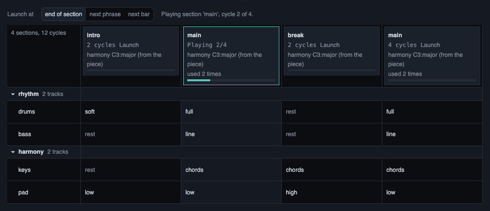

# Song structure

A piece can have sections: an intro, a main part, a break. This page shows how a piece declares its
sections, and what you can do with them in the page: see them in the Song grid, start a section on a
chosen line, pick what a track plays in it, and mute or solo a whole group in the Mixer.

## One declaration at the top

Every new piece that Claude writes starts with one `const song` at the top of the code. It says:

- the sections, with their lengths in cycles;
- for each track and each section, which variation of the track plays, or that it rests;
- optionally, groups: tracks that belong together, such as all the drums.

It is still ordinary Strudel. The same code plays in plain Strudel, outside Moontide. The page reads
the text of the declaration and does not run it to do so.

A small request on an older piece is made in place and does not restructure it. A piece without a song
plays and looks as it always did. If the page cannot read a song, it says why in one sentence and shows
no grid.

Claude reads the `structure` topic of the reference to write the declaration. It holds the form with
placeholder names, no section roles and no advice about style. The real section names come from Claude
and from you.

## The Song grid

For a piece with a readable song, the Parts view is called **Song**, and it shows the Song grid. The
tracks sit under foldable groups, with one column per section and the playing section marked.



*The Song grid of a small demo piece. Each column is a section: look at the highlighted header, which
says that the second section is playing and how far it has come. Each row is a track, listed under its
group (the small arrow folds a group), and each cell names the variation that the track plays in that
section, or says that it rests.*

The same kind of grid, written as text:

```
                 intro    main     break    main
 drums           soft     full     -        full
 bass            -        full     -        full
 lead            -        -        theme    theme
```

In this text, a dash means that the track rests in that section.

- **Launch a section.** Click a section header to start that section on the next line that the
  toolbar names: the end of the playing section, the next phrase or the next bar. Click the header
  again to cancel. If the sound is stopped, a click starts the piece at that section.
- **Pick a variation.** Click a cell to choose another variation for that track and section, or a
  rest. It takes over with your usual timing for hand edits and makes one version. When a section
  name is used twice, its cell is shared, and the list says so.
- **See if the notes fit.** A fixed variation says whether its notes fit the harmony of the section:
  fits, does not fit, or cannot check. It only says. It never blocks you. For a cell that does not
  fit, the page can prepare a request for Claude. It goes only when you press Enter.
- **Play after Stop** starts from the first section.

The page refuses a gesture, with a sentence, when another change waits for its line or when you have
typed text in the editor that you did not play yet. It does not throw your text away.

## Groups in the Mixer

The Mixer draws the groups of the song as frames around their strips. The frames fold together with the
grid: folding in one folds in the other, in this browser.

One click on the M or the S of a group mutes or solos every track below it, as one change and one
version. A group where only some of the tracks are muted shows a dashed button and a short count, and
one click then mutes all of them. A track that the Mixer cannot change is left as it is, and a note
under the group names it.

There is no fader for a group. Plain Strudel has no gain for a group of tracks, and a group fader would
not be true for MIDI tracks. Levels stay on the strips.

## Lights

Each strip and each group head has a small light. It blinks when a note of that track is heard. A
group's light shows the brightest light of the tracks below it, folded or open. With motion off in the
Session drawer, nothing blinks and a light stays lit while notes come.

## Ask Claude about it

A right-click on a section header, a track, a cell or a group opens the Ask box about that thing. The
cell tells Claude the section, the track, the variation and the fit that it showed. See
[Asking from the page](page-requests.md) for what happens next.

## What was verified

**Verified:**

- The declaration, the Song grid, the group frames and the lights are covered by automated tests and
  by checks in a real browser.
- The teaching of the form was tried with headless Claude sessions, one for each plain request. All six
  first pieces declared a structure that the page reads, and a small request on an older piece changed
  only the line that was asked for.

**Not verified:**

- Whether the Song grid reads well at 1080p and at 4K: section names, cells and the playhead.
- Whether a section launch and a cell change are heard on the line they name, not before and not after.
- Whether nested group frames in the Mixer look right at 1080p and at 4K.
- Whether the lights follow the notes in the browser and on a MIDI instrument, watched and heard.
- How the sections of a piece feel. That is judged by ear.
