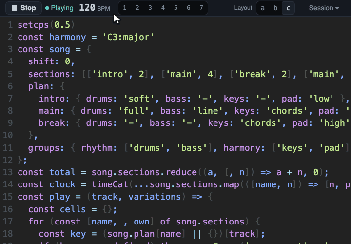

# The page and its views

The page is where you see and shape the music. Claude writes the code, the page plays it, and the
code stays on screen the whole time. Around the code, the page offers seven views. This page names
each part of the screen. You can read it before your first session or come back to it later. For the
first minute, see [First music](first-music.md).

## The code

The code is always visible and always editable. It is the one place where the music lives: every view
is another way to look at the same code, and every control in the page changes that code.

You can type in the editor yourself. A hand edit does not play until you press Ctrl+Enter. Claude
sees your hand edits and keeps them. Each edit you play becomes a version of the piece, so you can go
back to it (see [History and favorites](history.md)).

## Play, Stop and the banner

The Play or Stop button sits at the left of the top bar, with a word next to it that says Playing or
Stopped. The button names the action: Stop while music plays, Play while it is stopped. Play runs the
code in the editor, the same as Ctrl+Enter.

When a change cannot play, a banner appears under the top bar. It starts with "Change failed." and
adds one sentence about the music. The sentence is one of these:

- "Nothing is playing yet."
- "Sound is still stopped."
- "The previous music keeps playing."

Then it shows the first line of the error. Details shows all of it, Copy copies it, Ask Claude sends
it to Claude, and Dismiss hides the banner.

## The top bar

Besides Play and Stop, the top bar holds:

- the tempo, in BPM, and the cycle and beat that play;
- a countdown, when a change waits for its bar or phrase line;
- the buttons for the views, each with its key;
- the buttons for the layouts;
- the Requests button, which appears once you have sent a request from the page (see
  [Asking from the page](page-requests.md));
- the Session button, which opens the Session drawer.

## The Session drawer

The Session button opens a drawer over the page. It pushes nothing aside, so the music's view does not
jump. It holds five cards:

- **Session:** whether the page is connected, the name of this session (folder and port), and the
  reminder to right-click anything to ask Claude. The card ends with a short line that says Moontide is early.
- **MIDI:** the state of MIDI, for people who play instruments from the code.
- **Page requests:** whether your requests are live, which means they reach Claude right away, or
  wait for Claude's next action. The (i) next to it explains how to switch.
- **Settings:** when your own edits take over (now, on the next bar or on the next phrase), and a
  Motion switch. With motion off, the moving parts of the page stop.
- **Last change:** the number of the version that plays, for example v42.

The Session button shows a count when something needs you, such as a lost connection or a different
build. A failed change never adds to the count: the banner has its own place.

## Three layouts

The page has three layouts for the views. Press a, b or c, or use the buttons in the top bar.

- Layout a is a bottom strip, under the code. It is the first one you see.
- Layout b is a side panel, next to the code.
- Layout c is full screen over faint code.

## The views

The page has seven views. Press the key of a view to open it, and press the same key again to close
it. Escape closes the open view. Only a single view is open at a time. The keys do nothing while you type
in the editor: press Escape first to leave it.

*A tour of some of the views, with the music playing. Each view opens from its own button in the top bar, which
shows the key of the view, and the open view shows its name as well. The page here is in the layout that
fills the window, so each view has room to be read.*

1. **History** (key 1). Every version that played, newest first, as a list or as a tree, with what
   changed in each. A click on a version, or Enter on the selected one, brings it back.
2. **Timeline** (key 2). The named tracks, one lane each, with their notes laid out in time. You can
   select a note and change it. See [Small edits and editing by hand](editing.md).
3. **Mixer** (key 3). One strip for each track, with a fader, mute and solo. A move on a strip
   rewrites the code. A small light blinks when the track's note is heard.
4. **Parts** (key 4). The sections of a piece. For a piece that declares a song, this view is called
   Song and shows the Song grid. See [Song structure](song-structure.md).
5. **Jam** (key 5). For playing along: the scale in use on a piano or on a guitar neck, with the notes
   to avoid, and a line for the declared harmony and one for the heard harmony.
6. **Instruments** (key 6). One card for each MIDI instrument you described, with its port, its
   channels and an On and Off switch. It is for people with MIDI gear, and the page
   [MIDI instruments and the setup file](midi-instruments.md) explains it.
7. **Scratchpad** (key 7). A piano roll where you draw or play in a short motif, listen to it, and
   send it to Claude. It is also for people with MIDI gear, and the page [The Scratchpad](scratchpad.md)
   explains it. A label at the end of its toolbar reads Early experimental, because the whole Scratchpad
   is new and may still change.

## Right-click to ask

A right-click on anything in the page opens the Ask box. Type your request and press Enter to send it,
Shift+Enter for a new line, Esc to close the box. The request carries what you pointed at, so you can
say "make this softer" and Claude knows which thing. The Menu key and Shift+F10 open the box too, for
the control that has focus. Shift with a right-click keeps the browser's own menu.

Claude sees a request at once only when page requests are Live. The Page requests card in the Session
drawer shows whether they are Live or Waiting. A waiting request reaches Claude with its next action
in Moontide. To turn them on, ask Claude in the Code tab to turn page requests on, or type
`/mcp__moontide__page-requests-on` in Claude Code in a terminal.

See [Asking from the page](page-requests.md) for what happens to a request after you send it.

## What was verified

**Verified:**

- How the views, the layouts, the keys, the top bar, the Session drawer and the banner behave is
  covered by automated tests, and a drive of the real page in headless Chrome checks them.
- The page was used by hand on macOS with Chrome.

**Not verified:**

- The look of each view at 1080p and at 4K, and on a phone screen.
- The page in Edge, Safari and Firefox, and on Windows and Linux.
- Whether a screen reader says the names of the views right.
